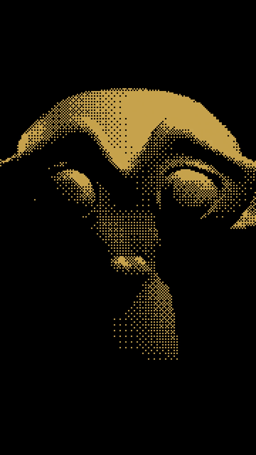
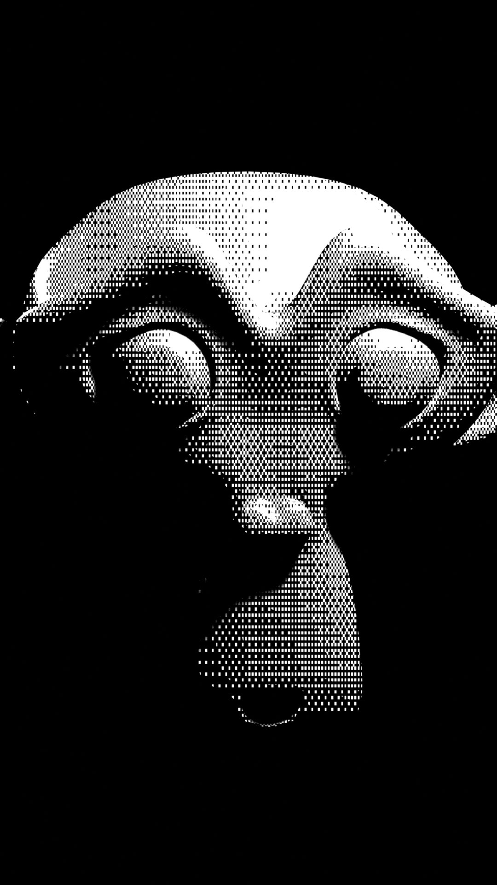
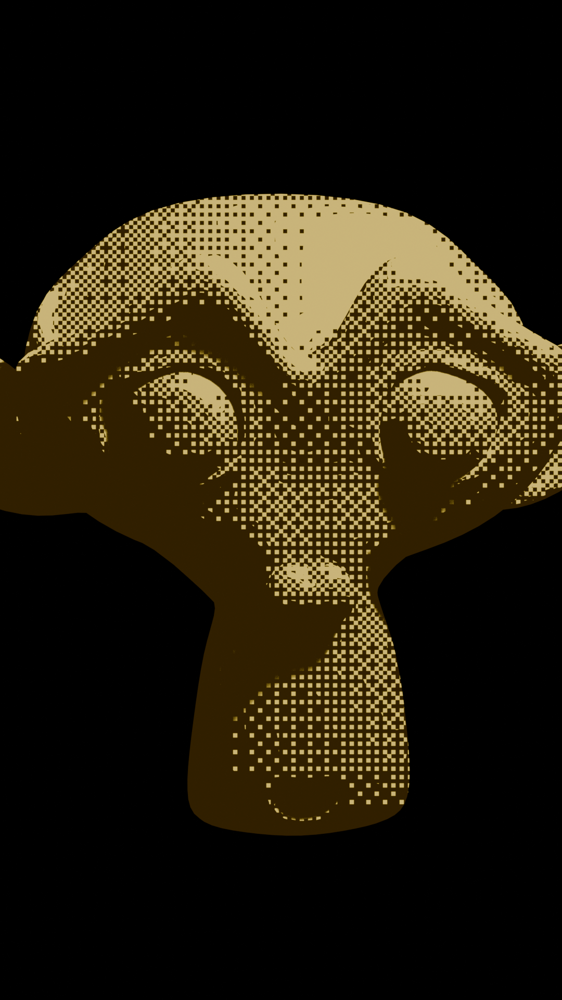
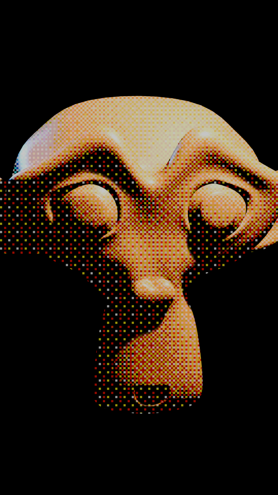
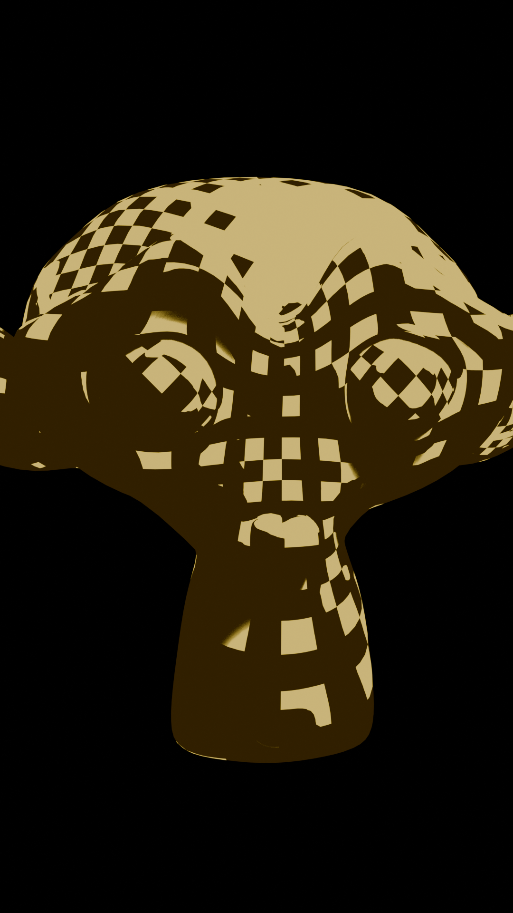

# 👾 DitherBlender

> **High-performance procedural retro dithering shader for Blender 4.2+ & 5.x.**  
> Runs **live in the 3D viewport at 60+ FPS** (EEVEE). **100% procedural math — zero external image textures required.**

[](https://www.blender.org)
[](https://www.blender.org)
[](#-how-it-works)
[](#-mathematical-bayer-interleaving)
[](LICENSE)

---

## 🎬 Showcase

<div align="center">
  
  <p><em>Real-time procedural Bayer dithering running live in the 3D viewport with temporal stability.</em></p>
</div>

### Style Presets

| 1-Bit Macintosh (1984) | Cyberpunk Amber CRT | 64-Color RGB (EGA/Genesis) | 3D Surface UV Halftone |
| :---: | :---: | :---: | :---: |
|  |  |  |  |
| Crisp binary monochrome | Warm monochrome phosphor | Multi-bit channel quantization | Pattern anchored to 3D mesh |

---

## ⚡ Highlights

- **Live Viewport Performance**: Runs natively inside the Material Shader Editor at **60+ FPS** in both **Material Preview** and **Rendered** modes (EEVEE).
- **Per-Material Flexibility**: Apply the retro dither effect to specific models while keeping other meshes, lights, and backgrounds realistic.
- **Dual Coordinate Modes**:
  - **Screen-Space (`1.0`)**: Locked to the display pixel lattice (CRT/LCD look).
  - **Object/UV-Space (`0.0`)**: Anchored directly to 3D surface geometry and rotates with the mesh (comic book / manga screentones).
- **100% Procedural Bayer Math**: Bit-interleaved arithmetic computes exact 4×4 (16-level) and 8×8 (64-level) threshold matrices on the fly without sampling external PNG textures.
- **Temporal Stability**: Zero video crawl, flickering, or swimming artifacts across moving cameras and animated geometry.
- **Organized Interface**: 5 clean collapsible panels with tooltips, min/max limits, and color swatches.

---

## 📁 Repository Structure

```
ditherblender/
├── dither_shader_live.blend   # Viewport Material Shader setup (EEVEE real-time)
├── create_shader_dither.py    # Python generator script to build the shader from scratch
├── examples/                  # Demo videos, animated GIFs, and render presets
├── .gitignore
└── LICENSE                    # MIT License
```

---

## 🧠 How It Works

```
[3D Scene Lights & Shadows]
            │
            ▼
┌───────────────────────┐       ┌───────────────────┐       ┌─────────────────────────────┐       ┌───────────────────┐       ┌─────────────────┐
│ Principled BSDF       │ ────> │ Shader to RGB     │ ────> │ Retro Dither Shader FX      │ ────> │ Emission Shader   │ ────> │ Material Output │
│ (Base Color/Roughness)│       │ (Captures Lit RGB)│       │ (5 Collapsible Panels)      │       │ (Strength = 1.0)  │       │ (Surface)       │
└───────────────────────┘       └───────────────────┘       └─────────────────────────────┘       └───────────────────┘       └─────────────────┘
                                                                    ▲
                                                                    │
                                                     [Texture Coordinate Node]
                                                     • Window (Screen Space)
                                                     • UV / Object (3D Surface)
```

1. **Light & Shadow Capture**: `Principled BSDF` (or any surface shader) reacts dynamically to scene lights and shadows.
2. **`Shader to RGB` Extraction**: Extracts the lit surface radiance into an RGB stream in EEVEE.
3. **Procedural Dithering**: `Retro_Dither_Shader_FX` calculates procedural 4×4 or 8×8 Bayer matrices and quantizes the values into custom color palettes or 1-bit monochrome steps.
4. **Direct Emission Display**: Emits the quantized pattern directly without re-lighting distortion.

---

## 🚀 How to Use

### Method 1: Append to Any Blender File (Recommended)

1. Open your target Blender project.
2. In the top menu, go to **`File` ➔ `Append...`** (or press `F4` ➔ `Append`).
3. Navigate to **`dither_shader_live.blend`** and double-click to look inside.
4. Open the **`Material`** folder, select **`Retro_Dither_Live_Material`**, and click **`Append`**.  
   *(Blender automatically imports all nested node groups: `Retro_Dither_Shader_FX`, `Shader_Bayer_4x4`, and `Shader_Bayer_8x8`)*.
5. In your 3D viewport, select your mesh, open the **Material Properties** tab (🌐), and select **`Retro_Dither_Live_Material`**.
6. Switch the 3D viewport shading to **Rendered** or **Material Preview** (EEVEE engine).

> [!IMPORTANT]
> **Match Your Exact Colors (`Standard` View Transform)**:  
> Blender defaults to **`AgX`** tonemapping, which desaturates bright colors into muted pastels.  
> Go to **`Render Properties` (📷) ➔ `Color Management` ➔ `View Transform`** and change it from `AgX` to **`Standard`** so your viewport displays the exact sRGB colors you pick in your palette swatches.

---

### Method 2: One-Click Python Script (Automated)

Paste this script into Blender's **Scripting** tab to append and assign the material automatically to your active selection:

```python
import bpy

blend_path = "/path/to/dither_shader_live.blend"  # Update path

# 1. Append material
with bpy.data.libraries.load(blend_path, link=False) as (data_from, data_to):
    if "Retro_Dither_Live_Material" in data_from.materials:
        data_to.materials = ["Retro_Dither_Live_Material"]

# 2. Assign to active object
mat = bpy.data.materials.get("Retro_Dither_Live_Material")
obj = bpy.context.active_object
if obj and mat:
    if obj.data.materials:
        obj.data.materials[0] = mat
    else:
        obj.data.materials.append(mat)
    print(f"Assigned {mat.name} to {obj.name}!")

# 3. Configure EEVEE and color management
bpy.context.scene.view_settings.view_transform = 'Standard'
bpy.context.scene.render.engine = 'BLENDER_EEVEE'
```

---

## 🎛️ Parameter & Slider Reference

All controls are organized into 5 collapsible panels inside **`Retro_Dither_Shader_FX`**:

### 1. Resolution & Grid
| Slider | Default | Range | Description |
| :--- | :---: | :---: | :--- |
| **`Pixel Size`** | `1` | `1 – 32` | Chunky pixel multiplier (`1` = native pixel grid, `2–4` = chunky retro). |
| **`Screen (1.0) / Object (0.0)`** | `1.0` | `0.0 – 1.0` | `1.0` = screen-space CRT raster; `0.0` = 3D surface-anchored UV dither. |
| **`Resolution X`** | `300.0` | `1.0 – 4096.0` | Virtual pixel grid horizontal resolution. |
| **`Resolution Y`** | `300.0` | `1.0 – 4096.0` | Virtual pixel grid vertical resolution. |
| **`Object UV Scale`** | `64.0` | `1.0 – 512.0` | Pattern density when using Object/UV coordinate mode. |

### 2. Dither Pattern
| Slider | Default | Range | Description |
| :--- | :---: | :---: | :--- |
| **`Matrix Mode (0=4x4, 1=8x8)`** | `0` | `0 or 1` | `0` = Punchy 16-level 4×4 Bayer; `1` = Silky 64-level 8×8 Bayer. |
| **`Dither Strength`** | `1.0` | `0.0 – 3.0` | Dither threshold amplitude (`0.0` = flat cel-shading, `1.0` = standard ordered dither). |

### 3. Tone Adjustments (Look)
| Slider | Default | Range | Description |
| :--- | :---: | :---: | :--- |
| **`Brightness`** | `0.0` | `-1.0 – +1.0` | Pre-dither exposure offset. |
| **`Contrast`** | `1.0` | `0.0 – 3.0` | Pre-dither contrast curve. |
| **`Midtone Gamma`** | `1.0` | `0.1 – 3.0` | Gamma response curve (raise `> 1.0` to pull detail out of shadows). |

### 4. Color & Palette
| Slider | Default | Range | Description |
| :--- | :---: | :---: | :--- |
| **`Color Mode (0=1Bit, 1=Levels, 2=RGB)`** | `0` | `0, 1, or 2` | `0` = 1-Bit Dual-Tone Tint; `1` = Grayscale Levels; `2` = Multi-Bit RGB. |
| **`Color Levels`** | `4` | `2 – 32` | Quantization steps per channel (for Modes 1 and 2). |
| **`1-Bit Threshold`** | `0.5` | `0.0 – 1.0` | Shadow / Highlight threshold cutoff for Mode 0. |
| **`Dark Color`** | *Black* | RGBA | Shadow tint color. |
| **`Light Color`** | *Amber* | RGBA | Highlight tint color. |

### 5. Output & Blend
| Slider | Default | Range | Description |
| :--- | :---: | :---: | :--- |
| **`Effect Mix (Dry/Wet)`** | `1.0` | `0.0 – 1.0` | Crossfade from un-dithered clean input (`0.0`) to full retro effect (`1.0`). |

---

## 🧮 Mathematical Bayer Interleaving

Standard dithering shaders rely on external 4×4 or 8×8 texture files that can suffer from mipmapping blur, path resolution issues, and file dependencies.

**DitherBlender** synthesizes the Bayer matrix purely through bitwise coordinate interleaving:

$$\text{Bit Extraction: } x_k = \left\lfloor \frac{x}{2^k} \right\rfloor \pmod 2, \quad y_k = \left\lfloor \frac{y}{2^k} \right\rfloor \pmod 2$$

$$\text{Bayer Value: } B(x, y) = \sum_{k=0}^{N-1} 4^{N-1-k} \cdot \left[ 2 \cdot (x_k \oplus y_k) + y_k \right]$$

This mathematical formulation guarantees:
- **Portability**: Opens in any Blender install without broken texture paths.
- **Precision**: Exact mathematical float thresholds without 8-bit texture rounding error.
- **Cross-Platform**: Runs identically on macOS (Metal), Windows (DirectX/Vulkan), and Linux.

---

## 🛠️ Rebuilding from Source

The entire `.blend` setup can be regenerated from scratch via command line:

```bash
blender -b --python create_shader_dither.py
```

---

## 📄 License

This project is licensed under the [MIT License](LICENSE) — free for both personal and commercial projects.
